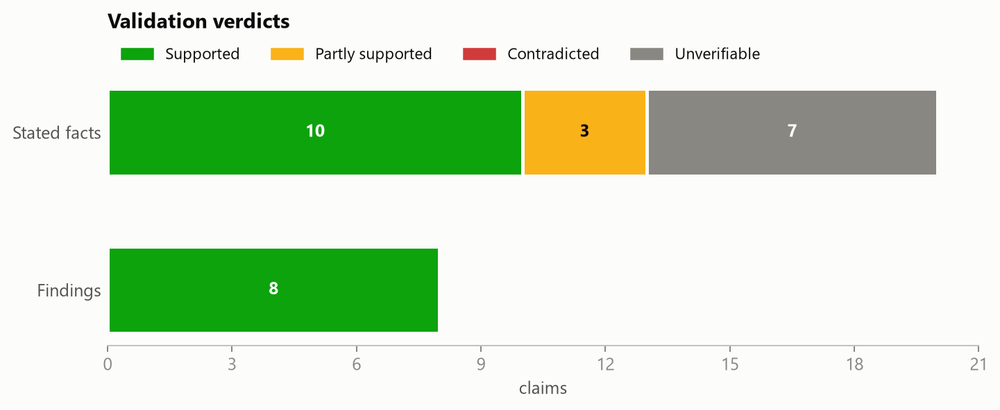

# Agentic Paper Review

This project reviews a scientific paper with a group of AI agents. They pull out the facts the paper states and check
each one on the web, test the paper's results against earlier work, look at how the paper is organized, and find
grammar mistakes. A critic then goes over their work and the pipeline writes a report. Each verdict in the report has
to quote a source that an agent read.

I tested it on the FlashAttention paper (Dao et al., 2022), which is in `papers/`.

## How I built it

These are the steps I followed, in order.

1. I picked FlashAttention as the test paper because it's full of hardware numbers and speedup claims that outside
   sources can confirm or contradict.
2. I wrote the code that reads the paper. It splits the PDF into sections using the PDF's own outline, then into
   short passages. For search I reused the hybrid retrieval from my earlier Ollama RAG lab. BM25 finds exact terms
   like "A100", EmbeddingGemma finds passages with the same meaning, and reciprocal rank fusion merges the two
   rankings.
3. I added the literature review, following PRISMA. An agent writes four search queries and runs them on arXiv,
   OpenAlex and Semantic Scholar. Duplicates are removed, along with the paper under review. Two screeners judge each
   abstract on their own, a third settles disagreements, and the report gives Cohen's kappa for the two screeners.
4. I wrote two extraction agents. One lists the facts the paper takes as given about the world, such as hardware
   specs. The other lists what the authors claim about their own work, such as speedups. Every item has to quote the
   paper, and items whose quote isn't in the text are dropped.
5. I built the validators, using the tool-calling setup from my LangGraph lab and the page-reading approach from
   Strap's research engine. Each fact and each finding gets a new agent that sees only that claim. It can search the
   web, read pages, search academic papers and the screened earlier work, and run Python. When it reads a page, the
   model writes a short digest with quotes, and quotes that aren't on the page are dropped. The final verdict has to
   cite quotes too. Each one is checked against the source text, and it has to be about the claim (embedding
   similarity of 0.3 or more). I added that second check after a run where an agent cited a line about CPU cores as
   evidence for a GPU memory fact.
6. I added the structure agent, which reviews the outline and uses embeddings to find passages that repeat each
   other, and the language agent, which reports grammar and spelling errors. I keep a language fix only when it
   changes a few words, so rewrites for style don't get through.
7. I added the critic, which rejects weak evidence and looks for conflicting verdicts, and the step that writes the
   summary. Every run produces a Markdown report and charts, and every model call and tool call is logged to
   `trace.jsonl`.
8. I connected everything in one LangGraph graph (`reviewer/graph.py`). Five branches start together after the paper
   is read. Validation waits for the facts, the findings and the literature, and the critic waits for everything. An
   optional pause lets a person remove facts before they're checked.
9. While building, I ran everything on a small 9B model to keep each test short. I did the final runs on Swift 1.5
   27B. The bigger model showed a few problems that I then fixed. It sometimes returned empty fact lists until I let
   it think before answering, an empty search query crashed the graph, and my planted false facts never got checked
   until fact selection started taking facts with numbers from every section.
10. Last, I wrote the evaluation (planted errors, agreement between runs, time against a manual review) and the video.

## Installation

I used Python 3.12 on Windows. Other systems should work the same way.

```bash
python -m venv .venv
.venv\Scripts\activate                # on Linux or macOS: source .venv/bin/activate
pip install -r requirements.txt
```

The video also needs ffmpeg on your PATH and a browser for Playwright:

```bash
playwright install chromium
```

The pipeline needs a server with an OpenAI-compatible API. Mine runs locally and gives three endpoints under one
address.

- Chat at `<OPENAI_COMPATIBLE_API>/api/llm/v1`, with tool calling and JSON-schema output. A llama.cpp server, vLLM,
  Ollama's `/v1` or OpenAI itself all work here.
- Web search at `<OPENAI_COMPATIBLE_API>/api/search`. The code sends `GET ?q=<query>&max=<n>` and reads a JSON answer
  with a `sources` list of `title`, `url` and `snippet`. I used SearXNG behind it.
- Embeddings at `<OPENAI_COMPATIBLE_API>/api/embeddings`, in the OpenAI format (`POST {"input": [...]}`, answer in
  `data[].embedding`). I used EmbeddingGemma.

## Configuration

Addresses and keys go in a `.env` file, which git ignores. Copy the example and edit it:

```bash
copy .env.example .env                # on Linux: cp .env.example .env
```

| Variable | What it's for |
|---|---|
| `OPENAI_COMPATIBLE_API` | address of the API server (chat, search and embeddings) |
| `LLM_BASE_URL` | set it only if chat runs on a different server |
| `LLM_MODEL` | model id, `swift-1.5-27b-xxs` by default in my case |
| `LLM_API_KEY` | key for the chat endpoint, if it needs one |
| `OPENALEX_API_KEY`, `SEMANTIC_SCHOLAR_API_KEY` | optional free keys; without them both services rate-limit quickly and get skipped |

What the review does is set in `protocol.toml`. That covers which literature sources to search, how many queries to
write, the screening criteria, whether to include the appendix, how many facts and findings to check, how many agents
run at once, and how many tool calls a validator may make. The sampling settings for each model (temperature, how
many requests it takes at once, how much it thinks) are in `MODEL_PROFILES` in `reviewer/config.py`.

## Running a review

```bash
python review.py papers/flashattention.pdf
```

A PDF works, and so does a Markdown or text file with `#` headings. The run prints each step as it goes. On my GPU
the FlashAttention review took 28 minutes.

To look over the facts before they're checked, add `--human`. The run stops after extraction, lists the facts with
their ids, and asks which ones to drop. Type the ids separated by spaces, or press Enter to keep them all.

Other options: `--model` picks another model on the same server, `--protocol` uses another protocol file, and
`--runs` writes the results somewhere other than `runs/`.

## Using the results

Each run writes a folder named after the paper, the model and the time, for example
`runs/flashattention_swift-1-5-27b-xxs_20261115-190315/`. Start with `report.md`.

| File | What's in it |
|---|---|
| `report.md` | the review: summary, PRISMA counts, every fact and finding with its verdict and quotes, structure and language issues, and the critic's notes |
| `results.json` | everything the agents produced, including each source a validator read |
| `trace.jsonl` | one line per model call or tool call, with the agent, timing and tokens |
| `run.json` | the model, its settings and the protocol, so the run can be repeated |
| `figures/` | charts of the PRISMA flow, the verdicts, issues by section, the agent timeline and tokens per agent |

On FlashAttention, the review found 17 earlier papers and kept 6. Of the 20 facts checked, 10 were supported, 3
partly supported and 7 couldn't be verified. All 8 findings were supported. It also found 9 structure issues and 17
language errors.



## Evaluation

```bash
python evaluate.py planted papers/flashattention.pdf
python evaluate.py agreement runs/<run folder>
python evaluate.py time runs/<run folder>
```

The first command makes a copy of the paper with ten mistakes hidden in it (false facts, inflated results, grammar
errors and a copied paragraph), reviews the copy and counts how many mistakes the review caught. It caught 8 of 10.
The second command has new agents check the same claims again and compares the verdicts. 79% matched. The third
compares the run's time with an estimate of the same work done by hand, about 7.4 hours, which makes the pipeline
about 16 times faster. The assumptions behind that estimate are in `evaluate.py`. Results go to `evaluation/`.

## The video

```bash
python video/build_video.py runs/<run folder>
```

This fills the slide template in `video/template.html` with the run's real data and records it to
`video/paper_review_pipeline.mp4`. The video is 1080p, just under three minutes, with no sound. Rendering takes about
three minutes.

## Project layout

```
review.py          runs a review
evaluate.py        planted errors, agreement and time
protocol.toml      the review settings
.env.example       template for addresses and keys
reviewer/          the pipeline: graph, agents, retrieval, literature search, web reading, report
papers/            the test paper
runs/              one folder per review
evaluation/        evaluation results
video/             slide template and video builder
```

## Limits

- The agents check claims against sources. They don't rerun the paper's experiments.
- `run_python` runs code the model wrote, so use it on a machine where that's acceptable.
- The model can misread a source. The report shows every quote, so a reader can check it.
- Paywalled papers and sites that block scripts can't be read, and claims that depend on them stay unverifiable.

## Team

I did this project alone.

| Member | Contributions |
|---|---|
| Saloua Oulad Sine | Everything: the pipeline and its agents, retrieval, the literature review, the validators, the evaluation, the report and the video |
