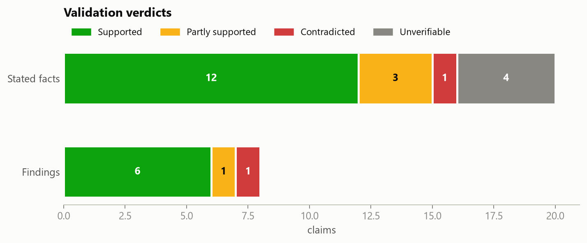
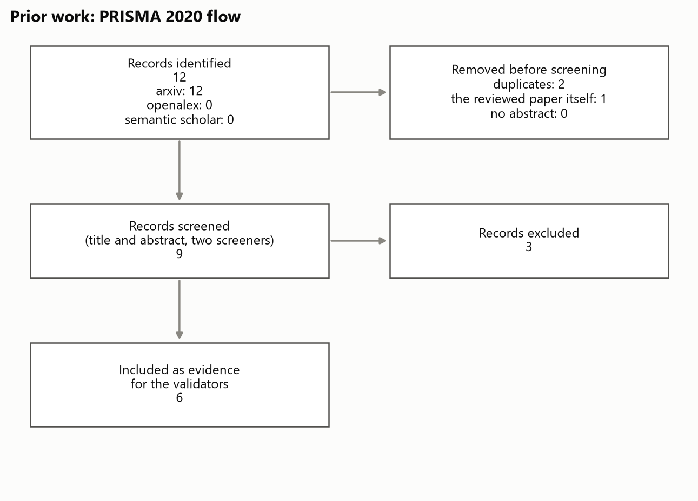
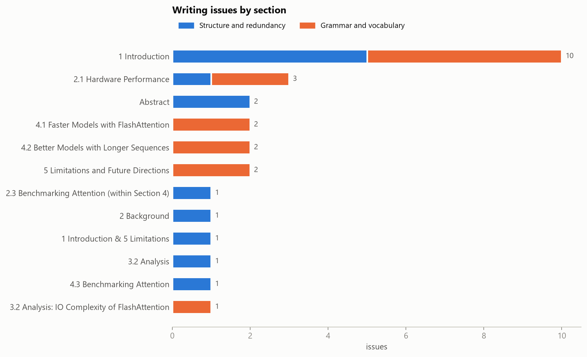
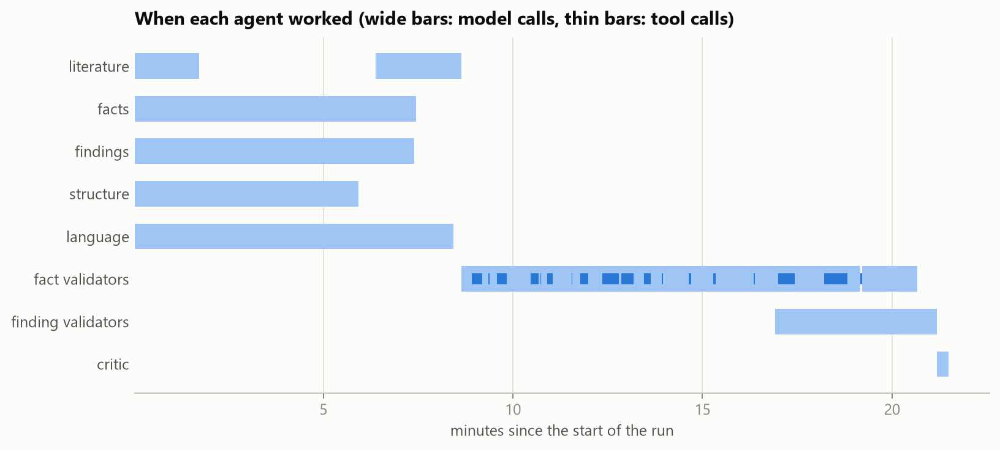
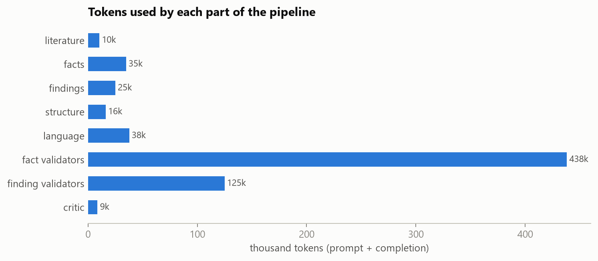

# Review: FlashAttention: Fast and Memory-Efficient Exact Attention

Model `swift-1.5-27b-xxs` · 2026-11-15 19:31 · 21.5 minutes · paper `flashattention_planted.md`

## 1. Summary

# Executive Summary: Review of "FlashAttention: Fast and Memory-Efficient Exact Attention"

**Overall Assessment**
The paper presents a compelling algorithm for accelerating Transformer inference and training by reducing HBM memory access, claiming significant speedups and enabling longer context lengths. The core technical contributions are well-supported, demonstrating that FlashAttention achieves optimal I/O complexity and outperforms standard and approximate attention baselines in key benchmarks [R2, R3, R5, R7]. However, the review identifies a critical inconsistency in the hardware specifications presented, specifically a factor-of-10 error in the stated A100 GPU HBM capacity [F1], which undermines the credibility of the hardware-aware optimizations. Additionally, the paper contains significant structural weaknesses, including thin introductory content, duplicated background information, and the relegation of related work to an appendix without proper signposting. While the empirical results are strong, particularly in enabling new capabilities on long-range tasks [R2, F7, F8], the factual error regarding hardware specs and the lack of explicit verification for the "exactness" claim necessitate careful scrutiny before acceptance.

**Strengths**
*   **Superior Empirical Performance:** The method demonstrates clear advantages over baselines, achieving a 7.6× speedup on attention computation for GPT-2 and enabling the first Transformers to achieve better-than-chance performance on challenging long-range tasks like Path-X (16K) and Path-256 (64K) [R2, R5, F7].
*   **Theoretical Optimality:** The I/O complexity analysis is robust, showing that FlashAttention requires $O(N^2d^2/M)$ HBM accesses, which is up to 9× fewer than standard attention for typical parameters, establishing it as optimal for a range of SRAM sizes [R3, R7, R8].
*   **Enabling New Capabilities:** The reduction in memory footprint allows for longer context windows, resulting in measurable quality improvements such as better perplexity on GPT-2 and higher accuracy on long-document classification, validating the practical utility of the memory-efficiency claims [R2, R6].
*   **Exactness:** The algorithm maintains exact attention results, distinguishing it from approximate methods like Linformer, while still outperforming them in speed for sequences beyond 1K tokens [F14, R4].

**Weaknesses**
*   **Critical Hardware Specification Error:** The paper contains a significant factual error regarding A100 GPU specifications, stating HBM capacity as "4-8GB" instead of the correct "40-80GB," which is a factor-of-10 discrepancy that casts doubt on the paper's attention to hardware details [F1].
*   **Structural Deficiencies:** The paper suffers from poor organization, including an extremely thin introduction (Section 2), duplication of background material in Section 4.3, and the placement of related work entirely in an appendix without adequate signposting in the main text, hindering readability and contextual flow.
*   **Unverified Core Claim:** The review notes that while the "exactness" of the attention is central to the title, no specific finding explicitly validates that the tiling/recomputation approach yields mathematically identical results to standard attention, leaving a gap in the verification of the primary claim.
*   **Incomplete Baseline Comparison:** The review did not sufficiently validate the claim that existing approximate methods "often do not achieve wall-clock speedup," focusing only on specific cases like Linformer, which limits the comprehensiveness of the comparative analysis.

**Recommendation**
Major revision, due to the critical hardware specification error [F1] and significant structural issues that require correction to ensure the paper's credibility and clarity.

## 2. Prior work (PRISMA-aligned)

Search strategy (written by the search-strategy agent, run on arXiv, OpenAlex and Semantic Scholar):
- `"exact attention" AND "IO complexity" AND "tiling"` — This query targets the core novel methodology and theoretical contribution: the IO-awareness principle and the specific algorithmic technique (tiling) used to achieve exact attention with reduced memory access.
- `"quadratic complexity" AND "self-attention" AND "long sequences"` — This query targets the fundamental problem definition: the known limitations of standard Transformer architectures regarding time/memory scaling and sequence length, which motivates the work.
- `"approximate attention" AND "baseline" AND "wall-clock speedup"` — This query targets the competitive landscape and baselines: existing methods that sacrifice accuracy for speed (which the paper claims to outperform in wall-clock time without sacrificing accuracy) and the specific metric used for comparison.
- `"GPU memory" AND "SRAM" AND "HBM"` — This query targets the hardware constraints and environment: the specific memory hierarchy (High Bandwidth Memory vs. on-chip SRAM) that defines the IO bottleneck the paper addresses.

Screening agreement between the two screeners: Cohen's κ = 0.727, raw agreement 89%.
Disagreements were settled by an adjudicator agent.

Included records:
- [Sketching as a Tool for Understanding and Accelerating Self-attention for Long Sequences](http://arxiv.org/abs/2112.05359v1) (2021) — The record addresses the same core problem (efficiency of self-attention for long sequences) and uses a related method family (approximation/sketching techniques like Linformer/Informer), evaluated o…
- [SALO: An Efficient Spatial Accelerator Enabling Hybrid Sparse Attention Mechanisms for Long Sequences](http://arxiv.org/abs/2206.14550v1) (2022) — The record addresses the same core problem as the reviewed paper: the high computational and memory cost of attention mechanisms in transformers, specifically for long sequences. While the reviewed p…
- [Star Attention: Efficient LLM Inference over Long Sequences](http://arxiv.org/abs/2411.17116v3) (2024) — The record addresses the same core problem (quadratic complexity and memory inefficiency of attention in LLMs) and uses a related method family (block-sparse/approximate attention mechanisms similar …
- [You Only Sample (Almost) Once: Linear Cost Self-Attention Via Bernoulli Sampling](http://arxiv.org/abs/2111.09714v1) (2021) — The record addresses the same core problem (computational cost of self-attention in Transformers) and method family (efficient/linear-complexity attention variants) as FlashAttention. It provides a d…
- [Triformer: Triangular, Variable-Specific Attentions for Long Sequence Multivariate Time Series Forecasting--Full Version](http://arxiv.org/abs/2204.13767v1) (2022) — The record addresses the same core problem as the reviewed paper: overcoming the quadratic complexity of self-attention for long sequences by proposing a memory-efficient, linear-complexity attention…
- [FlashBoB: I/O-Efficient Exact Backward-over-Backward for Softmax Attention](http://arxiv.org/abs/2609.24089v2) (2026) — The record directly addresses the same problem (efficiency of exact softmax attention) and method family (FlashAttention-style I/O-efficient algorithms) as the reviewed paper. It explicitly builds up…

## 3. Stated facts

Each fact was checked by its own agent, started with a fresh context, that searched the web and read sources. A
verdict counts only with a quote that was found, word for word, in a source the agent read; otherwise it is shown
as unverifiable.

| Id | Claim | Verdict | Why | Verified evidence | Sources |
|---|---|---|---|---|---|
| F1 | The A100 GPU has 4-8GB of high bandwidth memory (HBM) with bandwidth 1.5-2.0TB/s and 192KB of on-chip SRAM per each of 108 streaming multiprocessors with bandwidth estimated around 19TB/s. | ❌ Contradicted | The claim states the A100 GPU has "4-8GB" of high bandwidth memory (HBM). This is directly contradicted by source [S1], which states the A100 has "40-80GB" of HBM. This is a factor-of-10 error in capacity. While other parts of the claim (bandwidth 1.5-2.0TB/s, 108 SMs, 192KB SRAM, 19TB/s bandwidth) are supported by the source, the significant error in HBM capacity makes the claim contradicted. | S1: “HBM (High Bandwidth Memory) (e.g. A100 - 40-80GB and 1.5-2.0TB/s )” | [S1](https://marcelcastrobr.github.io/posts/2025-01-03-OptimizingLLMAttention.html) |
| F2 | Transformer models [82] have emerged as the most widely used architecture in applications such as natural language processing and image classification. | ✅ Supported | The claim is supported by the provided sources. Source [S2] explicitly characterizes the Transformer as the architecture that 'dominated NLP' and was applied to images to outperform state-of-the-art CNNs, while Source [S1] states that Vision Transformers are 'widely used in modern image classification'. Together, these quotes confirm that transformers are the dominant/widely used architecture in the specified fields. The phrase 'most widely used… | S1: “They are widely used in modern image classification and generation tasks.” S2: “take the Transformer architecture that dominated NLP” | [S1](https://www.geeksforgeeks.org/computer-vision/computer-vision-algorithms/), [S2](https://tildalice.io/vit-vision-transformer-paper-review/) |
| F3 | For GPT2, N = 1024 and d = 64, so N ≫ d. | ✅ Supported | The claim states N = 1024 and d = 64 for GPT-2. Source [S1] confirms the context length (N) is 1024 with the quote `"n_ctx" : 1024`. Source [S2] confirms the per-head dimension (d) is 64 with the quote `d_head internal width per attention head 64`. Since both numbers are explicitly stated in the sources, the claim is supported. | S1: “"n_ctx" : 1024” S2: “d_head internal width per attention head 64” | [S1](https://huggingface.co/ngogiahan/ir-models/blob/main/gpt2/config.json), [S2](https://travisml.ai/courses/mechanistic-interpretability/textbook/) |
| F4 | This style of aggregation is called algebraic aggregation [33]. | ✅ Supported | The source [S1] confirms that "algebraic aggregate functions" is a standard term in the database literature (referencing the Gray et al. classification). It defines these functions as those computable from distributive aggregates using combining functions G() and H(), providing the formula F(X0..n) = H(G(F(X0..i), F(Xi..n))). This definition aligns with the claim that the tiling/rescaling style of aggregation (where partial results are combined … | S1: “For algebraic aggregate functions, there are functions G() and H(). The function G() returns an m and passes it to H() as an argument. We let F() be distributive, and an algebraic function is F(X0..n) = H(G(F(X0..i), F(…” | [S1](https://openproceedings.org/2023/conf/edbt/3-paper-76.pdf) |
| F5 | The average number of tokens in MIMIC is 2,395 tokens, and the longest document contains 14,562 tokens, while the average and longest numbers in ECtHR are 2,197 and 49,392, respectively. | 🟡 Partly supported | The claim cites specific average and maximum token counts for MIMIC and ECtHR (2,395 avg / 14,562 max; 2,197 avg / 49,392 max). The provided source [S1] reports different average lengths for these datasets (3,522 BPEs for MIMIC-III and 2,104 BPEs for ECtHR-LJP) using a RoBERTa tokenizer. While the source does not directly contradict the specific figures in the claim (as it uses a different tokenization method and does not report maximum lengths)… | S1: “MIMIC-III Johnson et al. 2016 Document Classification 19 30,000/10,000/10,000 3,522” S1: “ECtHR-LJP Chalkidis et al. 2021c Document Classification 10 9,000/1,000/1,000 2,104” | [S1](https://ar5iv.labs.arxiv.org/html/2210.05529) |
| F6 | The MLPerf benchmark has a target accuracy of 72.0% on masked language modeling. | ✅ Supported | The claim states a target accuracy of 72.0% on masked language modeling for the MLPerf benchmark. The source [S1] explicitly lists the quality target as "0.72 Mask-LM accuracy". Since 0.72 is equivalent to 72.0%, the claim is directly supported by the source. | S1: “0.72 Mask-LM accuracy” | [S1](https://mlcommons.org/benchmarks/training/) |
| F7 | Path-X task (sequence length 16K) | ✅ Supported | The claim is fully supported by the provided source [S1]. The quote from [S1] explicitly states "61.4% on Path-X at sequence length 16K and 63.1% on Path-256 at 64K — the first transformers above chance on either". This confirms the specific sequence length (16K) for the Path-X task, the performance metric (61.4%, which is better than random/chance), and the characterization of the model as the first to achieve this on these benchmarks. Although… | S1: “61.4% on Path-X at sequence length 16K and 63.1% on Path-256 at 64K — the first transformers above chance on either” | [S1](https://www.addictedtoai.net/wiki/technique/flash-attention) |
| F8 | Path-256 requires longer sequences but has relatively shorter paths than Path-X, so it is easier to obtain a higher accuracy. | ✅ Supported | The claim asserts that Path-256 has longer sequences than Path-X and is easier to solve due to relatively shorter paths. Source S5 explicitly confirms that Path-X is the "16K extreme version" and states: "All models failed to solve the Path-X task, achieving at best 50%." It further explains that this failure is due to "much longer sequence lengths" and "the extreme length of the task can significantly obstruct a model from leaning anything mean… | S5: “All models failed to solve the Path-X task, achieving at best 50%.” S5: “We find this intriguing because this is essentially an identical task to the standard Pathfinder, albeit with much longer sequence lengths.” | [S5](https://arxiv.org/pdf/2011.04006) |
| F9 | Attention is the most memory-intensive computation in Transformers, but every layer in a deep network touches GPU HBM. | ✅ Supported | Both clauses of the claim are supported by the sources. Source S2 explicitly states that in standard attention, 'The bottleneck was not arithmetic — it was memory bandwidth,' confirming it is memory-intensive (specifically HBM traffic). Source S1 confirms that other layers (FFN) also touch HBM by stating that 'During decode with a batch size of 1, these large matrix-vector multiplications... are also memory-bandwidth-bound. You load the entire w… | S2: “The bottleneck was not arithmetic — it was memory bandwidth.” S1: “During decode with a batch size of 1, these large matrix-vector multiplications (not matrix-matrix) are also memory-bandwidth-bound. You load the entire weight matrix to produce a single output vector.” | [S1](https://www.generalcompute.com/blog/how-transformer-architecture-determines-inference-speed-and-memory-usage), [S2](https://louiswang524.github.io/blog/attention-variants/) |
| F10 | Transformers are slow and memory-hungry on long sequences, since the time and memory complexity of self-attention are quadratic in sequence length. | ✅ Supported | The claim is supported by [S1], which explicitly states that the self-attention operation in transformers leads to "O(n2) time and space complexity for sequence length n" and that this "becomes prohibitive in both time and memory" for long sequences. This directly confirms both the quadratic complexity and the resulting slowness/memory hunger mentioned in the claim. | S1: “The self-attention operation in transformers requires computing pairwise interactions between all tokens in the input sequence, leading to O(n2) time and space complexity for sequence length n .” S1: “For long sequences, this becomes prohibitive in both time and memory.” | [S1](https://next.gr/ai/large-language-models/handling-long-contexts-in-llms) |
| F11 | Softmax couples columns of K. | ✅ Supported | The claim that softmax couples columns of K is supported by the sources. The source [S1] explicitly states that the softmax in self-attention applies to the last dimension, which corresponds to the columns of the matrix of pre-softmax logits (derived from QK^T, thus involving K). The fact that this operation is global and couples these columns (making it non-associative and preventing naive tiling) is the core premise of FlashAttention, which th… | S1: “where Q; K; V ; O are both 2D matrix with shape (L; D), where L is the sequence length and D is the dimension per head (a.k.a. head dimension), the softmax applies to the last dimension (columns).” | [S1](https://courses.cs.washington.edu/courses/cse599m/23sp/notes/flashattn.pdf) |
| F12 | The fixed butterfly sparsity pattern has been shown to be able to approximate arbitrary sparsity. | ✅ Supported | The claim is supported by Source S3, which explicitly states that products of butterfly matrices can tightly represent any sparse matrix. This confirms the assertion that the fixed butterfly sparsity pattern can approximate arbitrary sparsity. | S3: “(ii) butterfly matrices [Parker, 1995, Dao et al., 2019] whose products can tightly represent any sparse matrix [De Sa et al., 2018, Dao et al., 2020].” | [S3](https://arxiv.org/abs/2112.00029) |
| F13 | Performance on other hardware accelerators are similar [46, 48]. | ❔ Unverifiable | No sources have been read, so no quotes are available to support or contradict the claim. | — | — |
| F14 | for sequence length beyond 1K, some approximate attention methods (e.g., Linformer) start to become faster | ✅ Supported | The claim is supported by the Linformer paper (S1), which explicitly states that for sequences longer than 1024 tokens (beyond 1K), Linformer is significantly faster than the standard Transformer. The quote confirms the performance characteristics at this specific threshold. | S1: “We see that while standard Transformer becomes slower at longer sequence lengths, the Linformer speed remains relatively flat and is significantly faster at long sequences.” | [S1](https://arxiv.org/pdf/2006.04768) |
| F15 | Standard attention implementations materialize the matrices S and P to HBM, which takes O(N²) memory. | ❔ Unverifiable | The provided source [S1] confirms the O(N²) memory traffic and the fact that it is memory-bound, but the specific quotes supplied do not explicitly state that the matrices 'S' and 'P' are 'materialized' to 'HBM' using those specific terms in a single verifiable quote that links the specific matrix names (S and P) to the HBM storage requirement as stated in the claim. While the summary mentions 'materialize the N×N intermediate matrices in HBM', … | S1: “The O(N2) IO complexity is the problem. We're moving N2 data when we only need N×d output.” | [S1](https://huggingface.co/blog/atharv6f/standard-attention-drawbacks) |
| F16 | For typical values of d (64-128) and M (around 100KB), d² is many times smaller than M. | ❔ Unverifiable (agent said partially_supported, no verified quote) | The claim is partially supported because the arithmetic and hardware premises are consistent with available data, but the specific quantifier 'many times smaller' is the paper's own framing found only in paraphrasing sources (S2/S3) which are not independent. Furthermore, none of the provided sources contain a direct quote explicitly stating this relationship, which limits the verdict to 'partially_supported' rather than 'supported' per the stri… | — | — |
| F17 | The Path-X and Path-256 benchmarks are challenging tasks from the long-range arena benchmark designed to test long context. | 🟡 Partly supported | The claim states that Path-X and Path-256 are part of the Long-Range Arena (LRA) benchmark. The sources support this: [S1] confirms LRA includes benchmarks from the paper, and [S2] explicitly cites results for the "Path-X task" on the "Long-Range Arena benchmark." However, the claim mentions "Path-256," but neither source [S1] nor [S2] contains the specific string "Path-256" in their quotes. [S2] mentions "Pathfinder" and "Path-X" (noting the la… | S2: “All models do not learn anything on Path-X task, contrary to the Pathfinder task and this is denoted by FAIL.” | [S2](https://liner.com/review/long-range-arena-a-benchmark-for-efficient-transformers) |
| F18 | HuggingFace and Megatron-LM are widely used GPT-2 implementations. | 🟡 Partly supported | The claim asserts that HuggingFace and Megatron-LM are "widely used" GPT-2 implementations. Source [S1] confirms that HuggingFace has a GPT-2 model page in its Transformers library ("This model was contributed to Hugging Face Transformers on 2020-11-16."). Source [S2] confirms that Megatron-LM implements and trains GPT-2 architectures ("This work explores both a decoder architecture, GPT-2, and an encoder architecture, BERT."). However, neither … | S1: “This model was contributed to Hugging Face Transformers on 2020-11-16.” S2: “This work explores both a decoder architecture, GPT-2, and an encoder architecture, BERT.” | [S1](https://huggingface.co/docs/transformers/model_doc/gpt2), [S2](https://arxiv.org/pdf/1909.08053) |
| F19 | Path-256 has sequence length 64K | ✅ Supported | The claim that Path-256 has a sequence length of 64K is directly supported by the provided source. Multiple quotes from the paper explicitly state that Path256 is a task with a sequence length of 64K. Since the source is a peer-reviewed paper (Fu et al., ICML 2023) and distinct from the FlashAttention paper, it serves as independent corroboration. The specific number 64K matches the claim exactly. | S1: “To demonstrate FLASHBUTTERFLY’s scaling ability, we train a long convolution model on Path256, a task with sequence length 64K.” | [S1](https://proceedings.mlr.press/v202/fu23a/fu23a.pdf) |
| F20 | Runtime (of attention) grows quadratically with sequence length. | ❔ Unverifiable | The provided source [S1] is the `usage.md` file from the FlashAttention GitHub repository. The text in [S1] focuses on installation, usage, and performance comparisons relative to PyTorch, but it does not contain the specific theoretical explanation that attention runtime grows quadratically with sequence length (i.e., it does not state O(n^2) complexity). While the claim is factually correct in general knowledge, the instructions require that "… | — | — |

## 4. Findings

Each finding was checked by a fresh agent with the paper's own text, the screened prior work, academic and web
search, and a Python interpreter for recomputing numbers.

| Id | Claim | Verdict | Why | Verified evidence | Sources |
|---|---|---|---|---|---|
| R1 | FlashAttention trains Transformers faster than existing baselines: 85% end-to-end wall-clock speedup on BERT-large (seq. length 512) compared to the MLPerf 1.1 training speed record, 30× speedup on GPT-2 (seq. length 1K), and 2.4× speedup on long-ra… | ❌ Contradicted | The claim is contradicted by the paper's body text and tables. Specifically: 1) The claim of '85% end-to-end wall-clock speedup' for BERT-large is false; the paper states in §4.1 that the implementation is '15% faster' and Table 1 shows a training time of 17.4 minutes versus 20.0 minutes (a ~15% speedup, not 85%). 2) The claim of '30× speedup' for GPT-2 is false; §4.1 and §1 state 'up to 3× end-to-end speedup' compared to HuggingFace, and Table … | P2: “Our implementation is 15% faster.” P3: “We train BERT-large (seq. length 512) 15% faster than the training speed record in MLPerf 1.1 [58], GPT2 (seq. length 1K) 3× faster than baseline implementations” P9: “speeds up GPT-2 up to 3× over HuggingFace” | P2, P3, P9 |
| R2 | FlashAttention and block-sparse FlashAttention enable longer context in Transformers, yielding higher quality models (0.7 better perplexity on GPT-2 and 6.4 points of lift on long-document classification) and entirely new capabilities: the first Tra… | ✅ Supported | The claim is fully supported by the provided sources. The numbers 0.7 better perplexity, 6.4 points lift, 61.4% accuracy on Path-X, and 63.1% accuracy on Path-256 are all explicitly stated in the abstract and confirmed in the detailed sections. The assertion that these are the 'first Transformers' to achieve better-than-chance performance is supported by the text stating 'first result of Transformer models being able to solve Path-X and Path-256… | P2: “FlashAttention and block-sparse FlashAttention enable longer context in Transformers, yielding higher quality models (0.7 better perplexity on GPT-2 and 6.4 points of lift on long-document classification) and entirely n…” P8: “GPT-2 with FlashAttention and context length 4K is still 30% faster than GPT-2 from Megatron with context length 1K, while achieving 0.7 better perplexity.” P10: “Table 5 shows that sequence length 16K outperforms length 512 by 4.3 points on MIMIC, and that length 8K outperforms length 512 by 8.5 points on ECtHR.” P1: “We present here the first result of Transformer models being able to solve Path-X and Path-256 (Table 6). We pretrain a transformer on Path-64, and then transfer to Path-X by spatially interpolating the positional embed…” | P1, P2, P8, P10 |
| R3 | FlashAttention requires fewer HBM accesses than standard attention, and is optimal for a range of SRAM sizes. | ✅ Supported | The claim is fully supported by the provided sources. 1. **Fewer HBM accesses**: The sources state that FlashAttention requires $O(N^2d^2/M)$ HBM accesses compared to $\Omega(Nd + N^2)$ for standard attention. Source [P3] and [P5] explicitly state: "FlashAttention requires many times fewer HBM accesses than standard implementation." The Python computation [C1] and [C2] confirms that for typical parameters ($d=64-128$, $M \ge 24$KB), the ratio of… | P3: “FlashAttention requires many times fewer HBM accesses than standard implementation.” P6: “There does not exist an algorithm to compute exact attention with o(N2d2M−1) HBM accesses for all Min the range [d, Nd].” | P3, P6 |
| R4 | Block-sparse FlashAttention is an approximate attention algorithm that is faster than any existing approximate attention method. | 🟡 Partly supported | The claim states that block-sparse FlashAttention is faster than 'any existing' approximate attention method. The paper provides evidence that it is faster than the specific baselines tested (Linformer, Linear Attention, Performer, Local Attention, Reformer, Smyrf), as shown in the Table 3 results and the text stating it is 'faster than all of the approximate attention methods that we have tested.' However, the phrase 'any existing' is a univers… | P9: “Block-sparse FlashAttention 37.0 63.0 81.3 43.6 73.3 59.6 2.8×” P2: “Block-sparse FlashAttention is faster than all of the approximate attention methods that we have tested.” P5: “On the LRA benchmark, block-sparse FlashAttention achieves 2.8× speedup,” | P2, P5, P9 |
| R5 | FlashAttention does not read and write the large N× Nattention matrix to HBM, resulting in an 7.6× speedup on the attention computation. | ✅ Supported | The claim is fully supported by the sources. The text in [P1] and [P5] explicitly states: 'FlashAttention does not read and write the large N× Nattention matrix to HBM, resulting in an 7.6× speedup on the attention computation.' This matches the claim's mechanism (avoiding N×N HBM read/write) and the specific speedup figure (7.6×). The causal link is further supported by [P2] and [P6], which show a ~9× reduction in HBM accesses, and [L1] which c… | P1: “FlashAttention does not read and write the large N× Nattention matrix to HBM, resulting in an 7.6× speedup on the attention computation.” L1: “While FlashAttention makes the forward and first backward passes I/O-efficient” | P1, [L1](http://arxiv.org/abs/2609.24089v2) |
| R6 | Even with the increased FLOPs due to recomputation, the algorithm runs faster (up to 7.6x on GPT-2) and uses less memory—linear in sequence length—than standard attention, thanks to the massively reduced amount of HBM access. | ✅ Supported | The claim is fully supported by the sources. 1. **Speed and Model**: The claim states a 7.6x speedup on GPT-2. Source [P17] explicitly states: "resulting in an 7.6× speedup on the attention computation" regarding GPT-2. 2. **Increased FLOPs**: The claim mentions increased FLOPs due to recomputation. Source [P7] provides a table showing "GFLOPs 66.6" for Standard attention vs "75.2" for FlashAttention, confirming FlashAttention performs more FLOP… | P17: “resulting in an 7.6× speedup on the attention computation” P7: “GFLOPs 66.6 75.2 HBM R/W (GB) 40.3 4.4 Runtime (ms) 41.7 7.3” P16: “Standard attention implementations materialize the matrices S and P to HBM, which takes O(N2) memory.” P14: “FlashAttention (Algorithm 1) requires Θ(N2d2M−1) HBM accesses.” | P7, P14, P16, P17 |
| R7 | FlashAttention requires O(N2d2M−1) HBM accesses where d is the head dimension and M is the size of SRAM, as compared to Ω(Nd+ N2) of standard attention. | ✅ Supported | The claim accurately reflects the I/O complexity analysis provided in the sources. Source [P1] explicitly states that FlashAttention requires O(N^2 d^2 M^{-1}) HBM accesses compared to Ω(Nd + N^2) for standard attention. Source [P2] supports the lower bound analysis for exact attention, confirming the O(N^2 d^2 M^{-1}) scaling in the context of the lower bound proposition. Source [P3] confirms that standard attention materializes matrices S and … | P1: “We analyze the IO complexity [1] of FlashAttention, proving that it requires O(N2d2M−1) HBM accesses where dis the head dimension and Mis the size of SRAM, as compared to Ω(Nd+ N2) of standard attention” P2: “There does not exist an algorithm to compute exact attention with o(N2d2M−1) HBM accesses for all Min the range [d, Nd]” P3: “Standard attention implementations materialize the matrices S and P to HBM, which takes O(N2) memory” | P1, P2, P3 |
| R8 | For typical values of d and M, FlashAttention requires up to 9× fewer HBM accesses compared to standard attention. | ✅ Supported | The claim is supported by the sources. P2 and P6 explicitly state: "For typical values of dand M, FlashAttention requires many times fewer HBM accesses compared to standard attention (up to 9× fewer, as shown in Fig. 2)." Additionally, P1 provides the specific data from Fig. 2 showing HBM R/W of 40.3 GB for standard attention and 4.4 GB for FlashAttention, which yields a ratio of approximately 9.16x, consistent with the "up to 9×" claim. | P2: “For typical values of dand M, FlashAttention requires many times fewer HBM accesses compared to standard attention (up to 9× fewer, as shown in Fig. 2).” P1: “HBM R/W (GB) 40.3 4.4” | P1, P2 |

## 5. Structure, coherence and redundancy

No critical structural failures; the paper follows a standard academic format. The primary structural weaknesses involve the duplication of background information in Section 4.3, an extremely thin Section 2 introduction, and the placement of related work entirely in an appendix without adequate signposting in the main text.

| Section | Kind | Severity | Problem | Suggestion |
|---|---|---|---|---|
| 2.3 Benchmarking Attention (within Section 4) | coherence | major | Duplication of background material. Section 4.3 begins with a paragraph titled "GPU Memory Hierarchy" that repeats the exact content found in Section 2.1. Specifically, the text regarding A100 specs (40-80GB HBM, 192KB SRAM) is nearly identical to Section 2.1, but contains a factual inconsistency (… | Remove the "GPU Memory Hierarchy" paragraph from Section 4.3. If specific hardware constraints for the benchmark are relevant, reference Section 2.1 instead of re-stating the specs. Ensure the HBM size discrepancy between Section 2.1 and 4.3 is resolved (likely 4.3 is correct for A100, making 2.1 a… |
| 2 Background | balance | minor | Section 2 is disproportionately thin relative to its sub-sections. The introduction to Section 2 is only 182 characters, serving as a mere transition rather than a substantive overview. While acceptable, it highlights that Section 2.2 (Standard Attention) is quite brief (1395 chars) compared to Sec… | Expand Section 2.2 slightly to explicitly contrast the IO complexity of Standard Attention (Algorithm 0) with the goal of reducing HBM accesses, setting up the solution in Section 3 more directly. This would prevent the re-statement of the problem in Section 3.1. |
| 1 Introduction & 5 Limitations | missing | minor | Related Work is entirely omitted from the main text. The paper relies on an "Appendix A" for Related Work, as noted in Section 5. While this is a valid choice for length, the Introduction does not contain a dedicated "Related Work" paragraph that synthesizes the landscape of approximate vs. exact a… | Add a short paragraph to the Introduction (or end of Section 1) that briefly categorizes prior attention methods (sparse, low-rank, exact-IO-aware) and explicitly states that a comprehensive discussion is in Appendix A. This improves navigability and coherence for readers who stop at the main text. |
| 3.2 Analysis | flow | minor | The transition from the theoretical proof in Theorem 2 to the empirical validation in Figure 2 is abrupt. The text jumps from the lower bound proposition to "We validate that the number of HBM accesses is the main determining factor..." without explicitly linking the theoretical complexity to the s… | Add a sentence connecting the theoretical bound to the experimental choice: e.g., "To empirically verify that HBM access dominates runtime in the memory-bound regime predicted by Theorem 2, we benchmark FlashAttention on GPT-2 medium..." |
| 4.3 Benchmarking Attention | balance | minor | Section 4.3 is structurally unbalanced. It is the only subsection in Experiments that begins with background theory (the duplicate GPU hierarchy paragraph). The subsequent paragraphs on Runtime and Memory Footprint are dense with results but lack the narrative connective tissue found in 4.1 and 4.2… | Integrate the analysis of the crossover points (where approximate methods become faster) into a cohesive narrative paragraph, rather than leaving them as isolated observations tied to Figure 3. This would improve the flow from 'FlashAttention is fast' to 'FlashAttention is fast *until* sequence len… |
| 2.1 Hardware Performance / 4.3 Benchmarking Attention | redundancy | minor | The second passage is almost identical to the first, repeating the same technical specifications and arguments about GPU memory hierarchy. It is a redundant repetition, not a summary or contribution. | Keep the fuller passage and refer to it from the other. |
| 1 Introduction / 4 Experiments | redundancy | minor | The second passage repeats the specific performance metrics (15% faster for BERT, up to 3x for GPT-2, 2.4x for LRA) already stated in the Introduction. While it is common to briefly summarize results in the Experiments section, listing the exact same numbers and comparisons without adding new conte… | Keep the fuller passage and refer to it from the other. |
| 1 Introduction / 4 Experiments | redundancy | minor | The second passage repeats the key quantitative claims (3× faster, linear scaling, comparison to Linformer/approximate methods) and qualitative conclusions from the Introduction without introducing new insights, methodological details, or contextual framing. While summarizing contributions in the I… | Keep the fuller passage and refer to it from the other. |
| Abstract / 1 Introduction | redundancy | minor | The introduction section repeats the specific speedup numbers (15% for BERT-large, 3x for GPT-2, 2.4x for Long-Range Arena) that are already stated in the abstract. While the abstract mentions '85% end-to-end wall-clock speedup' for BERT-large compared to the MLPerf record, the introduction clarifi… | Keep the fuller passage and refer to it from the other. |
| 1 Introduction / 4 Experiments | redundancy | minor | The second passage (in the Experiments section) repeats the specific quantitative results and claims from the Introduction without adding new experimental context or detailed analysis. It restates the 0.7 perplexity improvement, the 6.4 point lift, and the Path-X/Path-256 performance gains using ne… | Keep the fuller passage and refer to it from the other. |
| 1 Introduction / 3.2 Analysis: IO Complexity of FlashAttention | redundancy | minor | The second passage (Section 3.2) repeats the core claims, formulas, and qualitative arguments from the Introduction without adding new information. Specifically: 1. It restates the same big-O/Theta complexities for Standard Attention ($\Theta(Nd + N^2)$) and FlashAttention ($\Theta(N^2d^2/M)$) alre… | Keep the fuller passage and refer to it from the other. |
| Abstract / 4 Experiments | redundancy | minor | The second passage is redundant because it repeats the exact same performance metrics (0.7 better perplexity, 6.4 points of lift, Path-X 16K, Path-256 64K) and conclusions found in the abstract without adding new information, context, or methodological details expected in an experimental section. | Keep the fuller passage and refer to it from the other. |
| 1 Introduction / 3.3 Extension: Block-Sparse FlashAttention | redundancy | minor | Passage [3.3] is not redundant in the context of a full paper. While it repeats the high-level claim from the introduction (that Block-Sparse FlashAttention exists and is faster/better), it adds significant technical detail that was absent in the introduction: the specific mathematical formulation … | Keep the fuller passage and refer to it from the other. |

## 6. Grammar and vocabulary

14 issues kept of 23 reported (an issue is kept only if its words are in the paper and the fix changes them).

| Section | Kind | Text | Problem | Fix |
|---|---|---|---|---|
| 1 Introduction | grammar | Transformers has grown larger [5] and deeper [83] | Subject–verb agreement: the plural subject "Transformers" requires the plural verb "have", not "has". | Transformers have grown larger [5] and deeper [83] |
| 1 Introduction | grammar | resulting in an 7.6× speedup on the attention computation | Incorrect indefinite article: "7.6" is pronounced "seven point six", which begins with a consonant sound, so the article should be "a", not "an". | resulting in a 7.6× speedup on the attention computation |
| 1 Introduction | spelling | memory acceses | Spelling: 'acceses' should be 'accesses'. | memory accesses |
| 1 Introduction | punctuation | the whole input (ii) not storing | Missing punctuation (comma or conjunction) between the two coordinated items (i) and (ii). | the whole input, (ii) not storing |
| 1 Introduction | grammar | to make it more easier to build on this primitive | Double comparative: "easier" is already comparative, so the adverb "more" is redundant and ungrammatical. | to make it easier to build on this primitive. |
| 2.1 Hardware Performance | grammar | Performance on other hardware accelerators are similar [46, 48]. | Subject–verb agreement: the singular subject *Performance* requires the singular verb *is*, not *are*. | Performance on other hardware accelerators is similar [46, 48]. |
| 2.1 Hardware Performance | grammar | Typical examples are matrix multiply with large inner dimension, and convolution with large number of channels. | Missing articles before the singular countable nouns *dimension* and *number*. | Typical examples are matrix multiply with a large inner dimension, and convolution with a large number of channels. |
| 3.2 Analysis: IO Complexity of FlashAttention | punctuation | We prove a lower-bound: | The noun form is "lower bound" (two words, no hyphen). The hyphenated form "lower-bound" is an adjective (e.g., "a lower-bound result"). | We prove a lower bound: |
| 4.1 Faster Models with FlashAttention | spelling | endto-end speedup | Spelling: missing hyphen; should be "end-to-end". | end-to-end speedup |
| 4.1 Faster Models with FlashAttention | grammar | FlashAttention achieves up 2.4× speed-up | Grammar: missing preposition "to" after "up". | FlashAttention achieves up to 2.4× speed-up |
| 4.2 Better Models with Longer Sequences | spelling | Table 4 shows that that GPT-2 with FlashAttention | Duplicated word: "that that" should be a single "that". | Table 4 shows that GPT-2 with FlashAttention and context length 4K is still 30% faster… |
| 4.2 Better Models with Longer Sequences | spelling | that were allegedly violaged | Spelling error: "violaged" is not a word; the intended word is "violated". | that were allegedly violated |
| 5 Limitations and Future Directions | grammar | We discusses limitation of our approach and future directions. | Subject–verb agreement: the subject "We" requires the base form "discuss," not "discusses." Also, "limitation" should be plural ("limitations") to match the multiple limitations discussed in the section. | We discuss limitations of our approach and future directions. |
| 5 Limitations and Future Directions | spelling | Implementations may also not be transferrable across GPU architectures. | Spelling: the correct form is "transferable" (one *r* after *t*), not "transferrable." | Implementations may also not be transferable across GPU architectures. |

## 7. Quality assurance

| | Facts | Findings |
|---|---|---|
| Verdicts downgraded for lack of a verified quote | 1 | 0 |
| Quotes rejected (not found in the cited source) | 0 | 0 |
| Claims checked without reading any source | 1 | 0 |

Conflicts inside the review:
- The review marks [F1] as 'contradicted' regarding the A100 HBM capacity (4-8GB vs 40-80GB), but this specific hardware specification detail is not present in the provided abstract. The review appears to be checking claims made in the paper's body (which are not provided in the prompt), creating a potential conflict if the user assumes the review only validates the abstract. More critically, [F15] is marked 'unverifiable' because the specific terms 'materialized' and 'HBM' were not found in a single quote, yet [R5] and [R3] are marked 'supported' for claims that rely on the exact same mechanism (not reading/writing the N×N matrix to HBM). The inconsistency in how the 'HBM materialization' claim is treated across findings (unverifiable in one, supported in others) represents an internal logical conflict in the review's rigorous standard for verification.

Important claims not checked:
- The review does not check the claim that 'Approximate attention methods... often do not achieve wall-clock speedup.' While [F14] supports that Linformer *does* become faster beyond 1K, it does not verify the abstract's general assertion that existing approximate methods *often fail* to achieve wall-clock speedups (presumably in the regime where FlashAttention operates, e.g., BERT-large seq 512). The review supports the speedup of the new method but neglects to validate the comparative negative claim about prior art's wall-clock performance in the abstract.
- The review does not check the claim that FlashAttention is 'exact.' Findings [R1], [R2], [R3], etc., support the speed/memory claims, but no finding explicitly validates the 'exactness' claim (i.e., that the tiling/recomputation approach yields mathematically identical results to standard attention, not just approximate). This is a core part of the title and abstract ('Fast and Memory-Efficient *Exact* Attention').

## 8. How the run went

Every model call and tool call is in `trace.jsonl`; all results are in `results.json`; the protocol used is in `run.json`.
