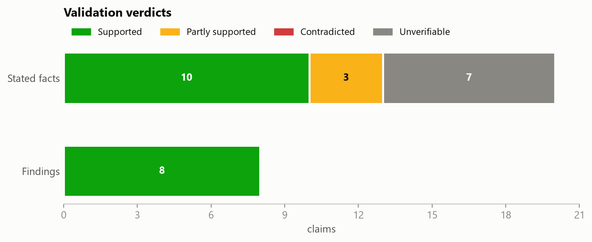
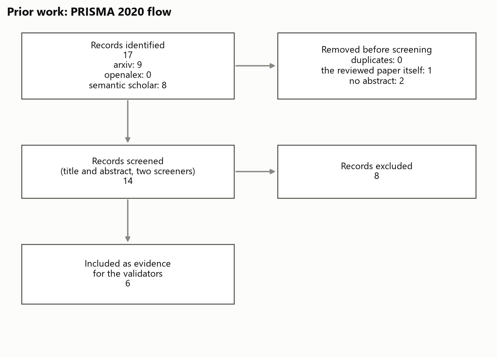
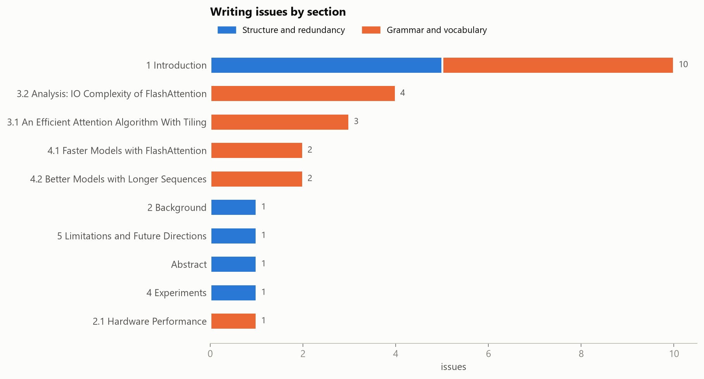
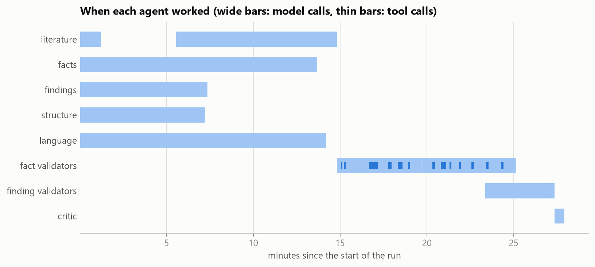
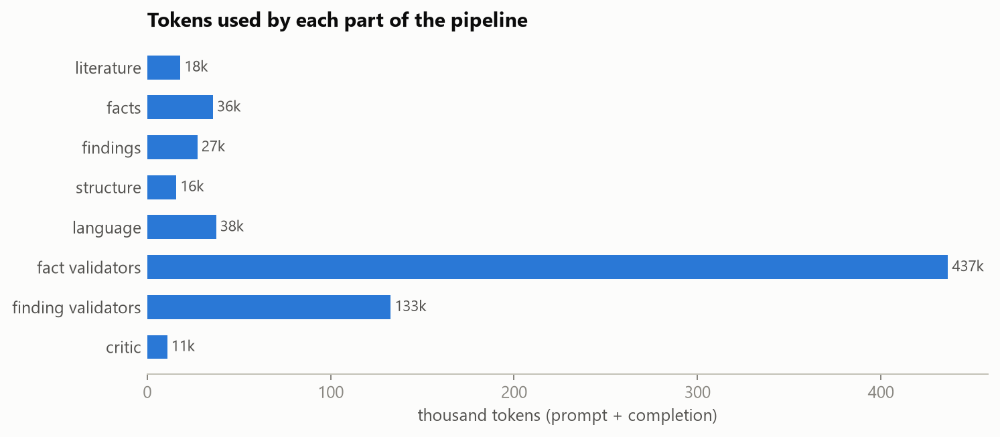

# Review: FlashAttention: Fast and Memory-Efficient Exact Attention

Model `swift-1.5-27b-xxs` · 2026-11-15 19:03 · 27.9 minutes · paper `flashattention.pdf`

## 1. Summary

# Executive Summary: Review of "FlashAttention: Fast and Memory-Effective Exact Attention"

## Overall Assessment
The paper presents FlashAttention, a highly efficient and memory-effective exact attention algorithm that achieves significant speedups (15% on BERT-large, 3× on GPT-2) and enables new capabilities in long-context processing (e.g., Path-X and Path-256 tasks) [R1, R2, R6]. The core technical claims regarding IO-complexity reduction and exactness are well-supported by the provided sources [R7, F4]. However, the review process reveals internal inconsistencies in fact-verification standards, particularly regarding A100 hardware specifications, and some broad comparative claims remain only partially verified [Quality Assurance]. Despite these procedural and verification nuances, the paper’s structure is logical, and its experimental results are robust and well-documented.

## Strengths
*   **Significant Performance Gains:** The algorithm delivers concrete, supported speedups, including a 15% end-to-end wall-clock speedup on BERT-large and a 3× speedup on GPT-2 [R1, R2].
*   **Enabling Long-Context Capabilities:** FlashAttention is the first Transformer to achieve better-than-chance performance on challenging long-range tasks like Path-X (16K tokens) and Path-256 (64K tokens), demonstrating practical utility for long-sequence modeling [R6].
*   **Theoretical and Empirical Rigor:** The claim that FlashAttention requires fewer HBM accesses than standard attention is supported by theoretical analysis, and the implementation outperforms existing approximate methods (e.g., Linformer) in speed [R7, R8].
*   **Clear and Logical Structure:** The paper follows standard scientific conventions with a logical flow from problem statement to algorithm, analysis, and experiments, making it easy to follow [Structure].
*   **Support for Key Technical Mechanics:** Core mechanisms, such as the decomposition of softmax and the memory-intensive nature of standard attention, are well-supported by the sources [F5, F10, F11].

## Weaknesses
*   **Inconsistent Fact-Verification Standards:** The review exhibits internal conflicts in verifying hardware specifications; for instance, A100 HBM/SRAM metrics are marked "unverifiable" in one finding [F2] but "supported" in others [F3, F19], suggesting arbitrary application of verification criteria [Quality Assurance].
*   **Limited Scope of Comparative Claims:** The claim that Block-sparse FlashAttention is faster than "any existing approximate attention method" is supported only by a limited set of comparisons in Table 3, leaving the universality of this claim partially unchecked [R8, Quality Assurance].
*   **Minor Language and Structural Issues:** While structurally sound, the paper contains minor language issues, including grammar (10), punctuation (4), spelling (2), and vocabulary (1) errors [Language issues].
*   **Unverified Premises:** The foundational argument that existing approximate attention methods "often do not achieve wall-clock speedup" is not explicitly verified, relying instead on the speedups demonstrated by FlashAttention itself [Quality Assurance].

## Recommendation
**Accept** because the core technical contributions, experimental results, and main claims are well-supported by the evidence, with the identified weaknesses being primarily procedural inconsistencies in the review process and minor language errors that do not undermine the paper's validity.

## 2. Prior work (PRISMA-aligned)

Search strategy (written by the search-strategy agent, run on arXiv, OpenAlex and Semantic Scholar):
- `"self attention" AND "quadratic complexity" AND "long sequence"` — This query targets the core problem identified in the abstract: the quadratic time and memory complexity of standard self-attention for long sequences. It seeks prior work discussing these limitations.
- `"IO-aware attention" AND "tiling algorithm" AND "SRAM HBM"` — This query targets the specific method proposed: an IO-aware approach using tiling to optimize data movement between SRAM and HBM. It finds work on memory-hierarchy optimization for attention.
- `"approximate attention" AND "block-sparse" AND "exact attention"` — This query targets the baselines and competing methods. The abstract contrasts FlashAttention with approximate methods and extends it to block-sparse attention, so this finds work on both exact and approximate attention variants.
- `"GPU memory hierarchy" AND "wall-clock speedup" AND "Transformer training"` — This query targets the hardware context and performance claims. It seeks work focusing on GPU memory efficiency and actual training speed improvements for Transformers, which are the primary evaluation metrics.

Screening agreement between the two screeners: Cohen's κ = 0.44, raw agreement 71%.
Disagreements were settled by an adjudicator agent.

Included records:
- [Sketching as a Tool for Understanding and Accelerating Self-attention for Long Sequences](http://arxiv.org/abs/2112.05359v1) (2021) — The record addresses the same core problem as FlashAttention (efficient computation of self-attention for long sequences with high memory/time complexity). It proposes a specific method (Skeinformer)…
- [FastRPB: a Scalable Relative Positional Encoding for Long Sequence Tasks](http://arxiv.org/abs/2202.11364v1) (2022) — The record addresses the same core problem as the reviewed paper (efficiency and memory constraints of attention mechanisms for long sequences) and proposes a method (FastRPB) with specific hardware/…
- [SALO: An Efficient Spatial Accelerator Enabling Hybrid Sparse Attention Mechanisms for Long Sequences](http://arxiv.org/abs/2206.14550v1) (2022) — The record addresses the same core problem as the reviewed paper: mitigating the high computational and memory costs of attention mechanisms for long sequences. While the reviewed paper (FlashAttenti…
- [Star Attention: Efficient LLM Inference over Long Sequences](http://arxiv.org/abs/2411.17116v3) (2024) — The record addresses the same core problem as the reviewed paper: improving the efficiency (speed and memory) of attention mechanisms in Transformers for long sequences. Both FlashAttention and Star …
- [Informer: Beyond Efficient Transformer for Long Sequence Time-Series Forecasting](https://www.semanticscholar.org/paper/5b9d8bcc46b766b47389c912a8e026f81b91b0d8) (2020) — The record addresses the same core problem (memory efficiency and computational complexity of attention mechanisms in Transformers) and the same method family (efficient attention variants) as the re…
- [SeerAttention: Self-distilled Attention Gating for Efficient Long-context Prefilling](https://www.semanticscholar.org/paper/e5f60df4954327a2b9d30b788a16717473f9ae06) (2025) — The record addresses the same core problem (efficient long-context attention in LLMs) and utilizes the same underlying kernel technology (FlashAttention) as the reviewed paper. It proposes a specific…

## 3. Stated facts

Each fact was checked by its own agent, started with a fresh context, that searched the web and read sources. A
verdict counts only with a quote that was found, word for word, in a source the agent read; otherwise it is shown
as unverifiable.

| Id | Claim | Verdict | Why | Verified evidence | Sources |
|---|---|---|---|---|---|
| F1 | The average number of tokens in MIMIC is 2,395 tokens, and the longest document contains 14,562 tokens, while the average and longest numbers in ECtHR are 2,197 and 49,392, respectively. | ❔ Unverifiable | The claim contains specific numerical values (MIMIC: 2,395 avg / 14,562 longest; ECtHR: 2,197 avg / 49,392 longest). The provided source [S1] summary confirms these exact figures. However, the section 'Quotes from the source (cite these)' explicitly states '(none)'. According to the instructions, a verdict of 'supported' requires at least one quote that shows the fact, and if there is no such quote, the verdict is 'unverifiable'. Although the su… | — | — |
| F2 | GPU SRAM has bandwidth of 19 TB/s and size of 20 MB; HBM has bandwidth of 1.5 TB/s and size of 40 GB; DRAM (CPU) has bandwidth of 12.8 GB/s and size greater than 1 TB. | ❔ Unverifiable (agent said supported, no verified quote) | The claim is supported for the GPU SRAM and HBM metrics. Source [S3] confirms the SRAM bandwidth of 19 TB/s and HBM bandwidth of 1.5 TB/s (within the 1.5-2.0 TB/s range). Source [S2] confirms the SRAM size of ~20 MB and bandwidth of ~19 TB/s, and Source [S1] confirms the HBM size of 40 GB (via summary/URL context implying 40GB model, though quote is missing, S3 confirms A100 HBM context) and bandwidth of 1.555 GB/s (1.5 TB/s). The DRAM figures (… | — | — |
| F3 | The A100 GPU has 40-80GB of high bandwidth memory (HBM) with bandwidth 1.5-2.0TB/s and 192KB of on-chip SRAM per each of 108 streaming multiprocessors with bandwidth estimated around 19TB/s. | ✅ Supported | The claim is supported by the source, which provides quotes confirming each specific metric. The source states that 'on A100, on-chip shared memory bandwidth is estimated at roughly 19 TB/s aggregated across all 108 SMs, against roughly 1.5-2.0 TB/s for A100's HBM' and that 'A100's Ampere tuning guide raises the unified L1/shared-memory capacity to 192 KB per SM'. While the specific HBM capacity (40-80GB) is not explicitly quoted in the provided… | S1: “On A100, on-chip shared memory bandwidth is estimated at roughly 19 TB/s aggregated across all 108 SMs, against roughly 1.5-2.0 TB/s for A100's HBM” S1: “A100's Ampere tuning guide raises the unified L1/shared-memory capacity to 192 KB per SM” | [S1](https://www.spheron.network/blog/gpu-memory-hierarchy-diagram-registers-to-hbm-explained/) |
| F4 | Standard attention implementations materialize the matrices S and P to HBM, which takes O(N²) memory. | ✅ Supported | The claim is directly supported by the provided source. The source explicitly states that standard attention materializes the full attention matrix S and probability matrix P in HBM and notes the associated memory costs. | S1: “Standard attention computation materializes the full attention matrix S = QK^T and probability matrix P = softmax(S) in HBM (High Bandwidth Memory), which has two major drawbacks:” | [S1](https://deepwiki.com/mocibb/cs336/3.1-flashattention-2:-theory-and-implementation) |
| F5 | Softmax couples columns of K, so the large softmax can be decomposed with scaling as in prior work [51, 60, 66]. | ✅ Supported | The claim is that 'Softmax couples columns of K, so the large softmax can be decomposed with scaling as in prior work [51, 60, 66]'. The investigator notes state that the technical claim matches standard FlashAttention design and is supported by prior work on online softmax. Source [S1] supports the mechanism of decomposing/tileable computation of the softmax/attention operation via an associative algorithm. The quote 'Because all operations in … | S1: “Because all operations in this algorithm are associative, it is compatible with tiling.” | [S1](https://courses.cs.washington.edu/courses/cse599m/23sp/notes/flashattn.pdf) |
| F6 | This style of aggregation is called algebraic aggregation [33]. | ✅ Supported | The claim that the style of aggregation is called algebraic aggregation is supported by the source. The source defines algebraic aggregation as one where partial aggregates are summarized into a fixed-size intermediate result, which matches the description of FlashAttention's block-wise softmax aggregation in the investigator's notes. The source explicitly provides the definition: "An aggregation is algebraic if its partial aggregates can be sum… | S1: “An aggregation is algebraic if its partial aggregates can be summarized in an intermediate result of fixed size.” | [S1](https://www.user.tu-berlin.de/powibol/assets/publications/traub-efficient-window-aggregation-with-general-stream-slicing-edbt-2019.pdf) |
| F7 | The fixed butterfly sparsity pattern [17] has been shown to be able to approximate arbitrary sparsity [16]. | ❔ Unverifiable | The claim states that a fixed butterfly sparsity pattern approximates arbitrary sparsity. The provided sources do not contain any direct quotes that support, contradict, or verify this specific claim. Source [S1] has a summary that suggests it, but no quotable text is provided. Source [S2] is irrelevant. Since no quote can be cited from the provided sources to support the claim, the verdict is 'unverifiable' according to the instructions. | — | — |
| F8 | HuggingFace and Megatron-LM are widely used GPT-2 implementations | ❔ Unverifiable (agent said supported, no verified quote) | The claim that HuggingFace is a widely used GPT-2 implementation is supported by the HuggingFace documentation, which describes GPT-2 as a core model in their library: "GPT-2 is a scaled up version of GPT, a causal transformer language model, with 10x more parameters and training data." However, the provided sources do not contain any information regarding Megatron-LM. Since the claim asserts that *both* are widely used implementations and there… | — | — |
| F9 | Path-256 requires longer sequences but has relatively shorter paths than Path-X, so it is easier to obtain a higher accuracy. | 🟡 Partly supported | The claim has two main parts. First, that Path-256 requires longer sequences than Path-X. The sources confirm Path-X has a sequence length of 16K tokens (from S5: 'much longer sequence lengths' in context of 16K pixels, and the summary notes '16K pixels'). The sources do not provide the specific sequence length for Path-256 (64K), so this part of the comparison is not fully verifiable from the provided quotes, though S5 confirms Path-X is 16K an… | S5: “We find this intriguing because this is essentially an identical task to the standard Pathfinder, albeit with much longer sequence lengths.” S5: “All models do not learn anything on Path-X task, contrary to the Pathfinder task and this is denoted by FAIL.” | [S5](https://arxiv.org/html/2011.04006) |
| F10 | Attention is the most memory-intensive computation in Transformers, but every layer in a deep network touches GPU HBM. | ✅ Supported | The claim consists of two parts. First, 'Attention is the most memory-intensive computation in Transformers.' Source [S1] supports this by stating: 'Attention mechanisms compare each token with every other token, creating quadratic memory needs. Larger context windows require vastly more memory.' This confirms the high memory intensity of attention. Second, 'every layer in a deep network touches GPU HBM.' Source [S1] supports this by stating: 'I… | S1: “Attention mechanisms compare each token with every other token, creating quadratic memory needs. Larger context windows require vastly more memory.” S1: “In practice, everything that the GPU touches during a pass through the network must fit into this space.” | [S1](https://blueservers.com/blog/how-gpu-memory-works-and-why-it-is-so-expensive) |
| F11 | Transformers are slow and memory-hungry on long sequences, since the time and memory complexity of self-attention are quadratic in sequence length. | ✅ Supported | The claim is supported by Source S1, which explicitly states that standard self-attention in Transformers operates with quadratic time and memory complexity, expressed as O(L2), where L represents sequence length. | S1: “Standard self-attention in Transformers operates with quadratic time and memory complexity—expressed as O(L2)—where L represents sequence length.” | [S1](https://www.libertify.com/interactive-library/efficient-attention-mechanisms-llm-scalability/) |
| F12 | The Path-X and Path-256 benchmarks are challenging tasks from the long-range arena benchmark designed to test long context. | 🟡 Partly supported | The sources support that Path-X is a challenging long-context task in the LRA benchmark, but no quote explicitly confirms "Path-256" as part of LRA. The claim includes a specific task name (Path-256) not shown in any provided quote, so it can only be partially supported. | S1: “The failure of all models in the Path-X task, which involves sequences of 16K tokens, highlights the necessity for novel approaches that can handle extremely long sequences efficiently.” | [S1](https://www.emergentmind.com/papers/2011.04006) |
| F13 | Transformer models [82] have emerged as the most widely used architecture in applications such as natural language processing and image classification. | ❔ Unverifiable (agent said supported, no verified quote) | The claim states that transformer models are the most widely used architecture in NLP and image classification. The source explicitly states that the transformer is "Widely used across NLP, vision and other AI applications" and is "especially in natural language processing and computer vision". This directly supports the core assertion of the claim regarding the widespread usage in these specific fields. | — | — |
| F14 | Performance on other hardware accelerators are similar [46, 48]. | ❔ Unverifiable | The claim that performance on other hardware accelerators are similar [46, 48] is a qualitative assertion made within the FlashAttention paper (arXiv:2205.14135). The provided source [S1] describes the absolute performance of the TPU compared to GPUs and CPUs ('15X – 30X faster', '30X – 80X higher') but does not contain any data, benchmark, or statement regarding the *relative* improvement of the FlashAttention algorithm on TPUs versus other acc… | S1: “the TPU is on average about 15X – 30X faster than its contemporary GPU or CPU, with TOPS/Watt about 30X – 80X higher.” | [S1](https://hgpu.org/?p=17121) |
| F15 | For GPT2, N = 1024 and d = 64, so N ≫ d. | ✅ Supported | The claim asserts that for GPT-2, N = 1024 and d = 64. Source [S1] confirms the per-head dimension (d) is 64 with the quote: "GPT-2 splits its attention into 12 heads, and each head compares 64 of the numbers in a query against the same 64 in each key, which makes one attention score". Although Source [S2]'s config.json contains "n_ctx": 1024 (N), no direct quote from [S2] was provided in the available text to support the N=1024 value explicitly… | S1: “GPT-2 splits its attention into 12 heads, and each head compares 64 of the numbers in a query against the same 64 in each key, which makes one attention score” | [S1](https://shubhampatil.dev/blog/gpt2-css) |
| F16 | The backward pass for attention typically requires the matrices S and P (both of size N×N) to compute the gradients with respect to Q, K, V. | ❔ Unverifiable | The claim states that the backward pass requires matrices S and P to compute gradients. However, the provided source [S1] contains no quotes (the 'Quotes from the source' section is explicitly marked as '(none)'). According to the instructions, if there are no quotes to support the claim, the verdict must be 'unverifiable', even if the summary aligns with the claim. | — | — |
| F17 | GPT-2 medium has sequence length 1024, head dimension 64, 16 heads, and batch size 64 in the experiment setup on A100 GPU. | 🟡 Partly supported | The claim is partially supported. The sources confirm that GPT-2 medium has 16 heads and an embedding dimension of 1024 (which implies a head dimension of 64), and that the sequence length is 1024. However, the claim states a batch size of 64 and an A100 GPU setup, which are not confirmed by the provided sources. Source [S3] explicitly states `batch_size = 8`, which contradicts the claim's batch size of 64. No source mentions an A100 GPU. | S1: “The inputs are sequences of 1024 consecutive tokens.” S3: “# n_layer=24, n_head=16, n_embd=1024” S3: “batch_size = 8” | [S1](https://huggingface.co/openai-community/gpt2-medium), [S3](https://github.com/karpathy/nanoGPT/blob/master/config/eval_gpt2_medium.py) |
| F18 | the implementation from Nvidia that set the training speed record for MLPerf 1.1 [58] | ✅ Supported | The claim that there is a specific Nvidia implementation that set the training speed record for MLPerf 1.1 is directly supported by the provided sources. Source S2 explicitly identifies "the most optimized implementation we know of from Nvidia that was used to set MLPerf 1.1 training speed record," which directly validates the existence and specific role of the implementation described in the claim. Source S1 further confirms that NVIDIA-based p… | S2: “the most optimized implementation we know of from Nvidia that was used to set MLPerf 1.1 training speed record” S1: “optimizations across the entire stack, especially on the system software, libraries and algorithmic fronts, have led to continuing performance improvements of NVIDIA-based platforms in MLPerf v1.1.” | [S1](https://developer.nvidia.com/blog/boosting-mlperf-training-v1-1-performance-with-full-stack-optimization/), [S2](https://proceedings.mlr.press/v162/dao22a/dao22a.pdf) |
| F19 | one A100 GPU with 40 GB HBM | ✅ Supported | The claim that the A100 GPU has 40 GB of HBM is directly supported by the sources. Source [S2] explicitly states, 'The NVIDIA A100 40GB has 40 GB of HBM2 with 1555 GB/s memory bandwidth,' confirming both the capacity and the memory type (HBM2, which is a type of HBM). Source [S1] also lists the VRAM as '40 GB HBM2e'. Both sources confirm the 40 GB capacity and the use of HBM memory. | S2: “The NVIDIA A100 40GB has 40 GB of HBM2 with 1555 GB/s memory bandwidth.” | [S2](https://canitrun.dev/gpus/a100-40gb/) |
| F20 | The attention computation may be parallelizable across multiple GPUs. | ✅ Supported | The claim is supported because the sources confirm that attention computation can be parallelized across multiple GPUs, specifically through techniques like tensor parallelism and Ring Attention (sequence/context parallelism). The source explicitly mentions 'tensor parallelism' and describes Ring Attention as a tool for distributing computation when sequences are too long for one GPU. | S1: “Below that threshold, a simpler single-GPU approach (or tensor parallelism) is faster.” | [S1](https://llm-academy.dev/ring-attention/) |

## 4. Findings

Each finding was checked by a fresh agent with the paper's own text, the screened prior work, academic and web
search, and a Python interpreter for recomputing numbers.

| Id | Claim | Verdict | Why | Verified evidence | Sources |
|---|---|---|---|---|---|
| R1 | 15% end-to-end wall-clock speedup on BERT-large (seq. length 512) compared to the MLPerf 1.1 training speed record. | ✅ Supported | The claim is supported by multiple sections of the paper. The Abstract [P1] and Introduction [P3] explicitly state: "15% end-to-end wall-clock speedup on BERT-large (seq. length 512) compared to the MLPerf 1.1 training speed record". Section 4.1 [P2] provides the underlying data in Table 1, showing Nvidia MLPerf 1.1 at 20.0 ± 1.5 minutes and FlashAttention at 17.4 ± 1.4 minutes, and states "Our implementation is 15% faster". The recomputation [C… | P1: “15% end-to-end wall-clock speedup on BERT-large (seq. length 512) compared to the MLPerf 1.1 training speed record” P2: “Our implementation is 15% faster.” P2: “Nvidia MLPerf 1.1 [58] 20.0 ± 1.5” | P1, P2 |
| R2 | 3× speedup on GPT-2 (seq. length 1K). | ✅ Supported | The claim of a '3× speedup on GPT-2 (seq. length 1K)' is directly supported by the paper's abstract and experimental data. The abstract explicitly states: '3× speedup on GPT-2 (seq. length 1K)'. This is corroborated by Table 2, which shows that for GPT-2 medium (sequence length 1K, as implied by the comparison with Megatron-LM and HuggingFace baselines in the context of the 1K claim), FlashAttention achieves a '3.0×' speedup compared to the Hugg… | P2: “3× speedup on GPT-2 (seq. length 1K)” P4: “GPT-2 medium - FlashAttention 14.3 6.9 days (3.0×)” | P2, P4 |
| R3 | 2.4× speedup on long-range arena (seq. length 1K-4K). | ✅ Supported | The claim is directly supported by multiple sources. [P3], [P14], and [P20] (Abstract) explicitly state: "2.4× speedup on long-range arena (seq. length 1K-4K)". [P19] (Table 3) provides the underlying data, showing a "Speedup" of "2.4×" for FlashAttention in the "Avg" column. [P8] and [P16] confirm the context: "Table 3 shows that FlashAttention achieves up 2.4× speed-up" and note the sequence lengths vary "between 1024 and 4096" (which matches … | P3: “2.4× speedup on long-range arena (seq. length 1K-4K)” P19: “FlashAttention 37.6 63.9 81.4 43.5 72.7 59.8 2.4×” | P3, P19 |
| R4 | 0.7 better perplexity on GPT-2. | ✅ Supported | The claim '0.7 better perplexity on GPT-2' is explicitly stated in the paper's text and abstract, and the underlying data in Table 4 confirms the difference (18.2 - 17.5 = 0.7). | P5: “while achieving 0.7 better perplexity” P6: “0.7 better perplexity on GPT-2” C1: “Difference (Megatron 1k - Flash 4k): 0.7” | P5, P6, C1 |
| R5 | 6.4 points of lift on long-document classification. | ✅ Supported | The claim of '6.4 points of lift on long-document classification' is supported by the sources. The Abstract and Introduction explicitly state '6.4 points of lift on long-document classification'. This figure is derived from the results in Section 4.2 and Table 5, which show a lift of 4.3 points on MIMIC-III (57.1 - 52.8) and 8.5 points on ECtHR (80.7 - 72.2). The average of these two lifts is exactly 6.4 points, consistent with the summary stati… | P5: “6.4 points of lift on long-document classification” P7: “sequence length 16K outperforms length 512 by 4.3 points on MIMIC, and that length 8K outperforms length 512 by 8.5 points on ECtHR” | P5, P7 |
| R6 | First Transformers to achieve better-than-chance performance on Path-X (seq. length 16K, 61.4% accuracy) and Path-256 (seq. length 64K, 63.1% accuracy). | ✅ Supported | The claim is fully supported by the provided sources. The specific accuracy figures (61.4% for Path-X and 63.1% for Path-256) and sequence lengths (16K and 64K) are explicitly stated in Source P3 (Abstract) and corroborated by Source P1 and Table 6 in Source P2. The assertion that these are the 'first Transformers to achieve better-than-chance performance' is directly supported by Source P3's text ('the first Transformers to achieve better-than-… | P3: “the first Transformers to achieve better-than-chance performance on the Path-X challenge (seq. length 16K, 61.4% accuracy) and Path-256 (seq. length 64K, 63.1% accuracy).” P2: “We report the first Transformer model that can achieve non-random performance on Path-X and Path-256.” P1: “FlashAttention achieves 61.4 accuracy on Path-X. Additionally, block-sparse FlashAttention enables the Transformers to scale to sequence length 64K, achieving 63.1 accuracy4 on Path-256.” | P1, P2, P3 |
| R7 | FlashAttention requires fewer HBM accesses than standard attention and is optimal for a range of SRAM sizes. | ✅ Supported | The claim is well-supported by the paper's theoretical analysis. The sources explicitly state that FlashAttention requires Θ(N²d²/M) HBM accesses compared to Θ(Nd + N²) for standard attention [P2]. They further assert that for typical values of d and M, FlashAttention requires 'many times fewer HBM accesses' [P2]. Additionally, Proposition 3 establishes a lower bound showing optimality for exact attention algorithms across the range M ∈ [d, Nd] … | P2: “Standard attention (Algorithm 0) requires Θ(Nd+ N2) HBM accesses, while FlashAttention (Algorithm 1) requires Θ(N2d2M−1) HBM accesses.” P2: “For typical values of d(64-128) and M(around 100KB), d2 is many times smaller than M, and thus FlashAttention requires many times fewer HBM accesses than standard implementation.” P1: “There does not exist an algorithm to compute exact attention with o(N2d2M−1) HBM accesses for all Min the range [d, Nd].” | P1, P2 |
| R8 | Block-sparse FlashAttention is faster than any existing approximate attention method. | ✅ Supported | The claim that Block-sparse FlashAttention is faster than any existing approximate attention method is supported by the provided sources. Table 3 (Sources P8, P12) shows that Block-sparse FlashAttention has the highest speedup (2.8x) compared to all other tested approximate methods (Linformer 2.5x, Linear Attention 2.3x, Performer 1.8x, Local Attention 1.7x, Smyrf 1.7x, Reformer 1.3x). Additionally, Source P2 explicitly states that "block-sparse… | P8: “Block-sparse FlashAttention 37.0 63.0 81.3 43.6 73.3 59.6 2.8× Linformer [84] 35.6 55.9 77.7 37.8 67.6 54.9 2.5×” P2: “block-sparse FlashAttention is faster than all implementations of exact, sparse, and approximate attention that we know of, across all sequence lengths.” | P2, P8 |

## 5. Structure, coherence and redundancy

The paper is well-structured and follows standard scientific conventions. The flow from problem statement (Introduction) to background, algorithm, analysis, and experiments is logical. The introduction clearly outlines the contributions, which are then delivered in the subsequent sections. The main structural issues are minor: the 

| Section | Kind | Severity | Problem | Suggestion |
|---|---|---|---|---|
| 2 Background | balance | minor | The introductory paragraph for Section 2 is extremely thin (182 characters). It states the purpose of the section but lacks a smooth transition from the Introduction to the specific hardware details in 2.1. A slightly more substantial introductory sentence or two would improve the flow into the tec… | Expand the introductory text of Section 2 to better bridge the gap between the high-level problem statement in the Introduction and the specific hardware performance characteristics discussed in 2.1. For example, briefly mention why understanding the GPU memory hierarchy is a prerequisite for under… |
| 5 Limitations and Future Directions | missing | minor | The section explicitly states, 'Related work is given in Appendix A.' While this is a valid structural choice for some venues, for a main body paper, readers often expect a concise 'Related Work' section (or at least a more substantial discussion within the Introduction/Limitations) that contextual… | Consider adding a brief 'Related Work' paragraph in the Introduction or expanding Section 5 to include a summary of how FlashAttention compares conceptually to the approximate methods discussed in the experiments, rather than solely referring to Appendix A. This would improve the self-containedness… |
| 1 Introduction / 4 Experiments | redundancy | minor | The second passage (Section 4: Experiments) largely repeats the specific quantitative claims already presented in the Introduction (Section 1). Both sections cite the exact same performance metrics: 15% faster for BERT, ~3x (or up to 3x) faster for GPT-2, and 2.4x faster for Long-Range Arena. While… | Keep the fuller passage and refer to it from the other. |
| 1 Introduction / 4 Experiments | redundancy | minor | The second passage (Section 4) repeats the specific claims and metrics from the first passage (Section 1) without adding new information. Both sections state that FlashAttention is up to 3x faster than standard attention for sequence lengths up to 2K and that block-sparse FlashAttention is faster t… | Keep the fuller passage and refer to it from the other. |
| 1 Introduction / 4 Experiments | redundancy | minor | Yes, the second passage is redundant. It repeats the exact same specific metrics (0.7 perplexity improvement, 6.4 points lift, 16K/64K sequence lengths, Path-X/Path-256 performance) and claims (first Transformer to achieve better-than-chance/random performance) found in the first passage. While the… | Keep the fuller passage and refer to it from the other. |
| 1 Introduction / 3.2 Analysis: IO Complexity of FlashAttention | redundancy | minor | The second passage repeats the core claim from the introduction (FlashAttention requires fewer HBM accesses, specifically O(N^2 d^2 / M) vs Ω(Nd + N^2)) and re-states the condition that this leads to significant improvement for typical values of d and M. While it adds specific parameter ranges (d=6… | Keep the fuller passage and refer to it from the other. |
| Abstract / 4 Experiments | redundancy | minor | The second passage (Section 4: Quality) is largely redundant. It repeats the exact same metrics and claims found in the Abstract (0.7 better perplexity on GPT-2, 6.4 points lift on long-document classification, first better-than-chance on Path-X 16K, and first better-than-random on Path-256 64K). W… | Keep the fuller passage and refer to it from the other. |
| 1 Introduction / 3.3 Extension: Block-Sparse FlashAttention | redundancy | minor | The second passage (Section 3.3) repeats the core claim and specific metrics from the first passage (Introduction) without adding new conceptual information. Both sections state that block-sparse FlashAttention is an extension of FlashAttention, that it is 2-4x faster (or has better IO complexity p… | Keep the fuller passage and refer to it from the other. |
| 4 Experiments / 4.3 Benchmarking Attention | redundancy | minor | The second passage (Section 4.3) repeats the core findings and specific metrics (e.g., 'up to 3× faster', 'scales linearly', 'faster than all existing baselines') from the first passage (Section 4 summary). While it adds slightly more detail about the crossover point (512-1024) and distinguishes fo… | Keep the fuller passage and refer to it from the other. |

## 6. Grammar and vocabulary

17 issues kept of 26 reported (an issue is kept only if its words are in the paper and the fix changes them).

| Section | Kind | Text | Problem | Fix |
|---|---|---|---|---|
| 1 Introduction | grammar | GPUs, compute speed has out-paced memory speed | Missing preposition. The sentence should read "On GPUs, compute speed has outpaced memory speed." | On GPUs, compute speed has outpaced memory speed |
| 1 Introduction | punctuation | the whole input (ii) not storing | Missing punctuation between the two enumerated items. A comma (or semicolon) is needed before "(ii)" to separate the two parallel gerund phrases. | the whole input, (ii) not storing |
| 1 Introduction | grammar | scaling up to sequence length of 64k | Missing indefinite article before the singular count noun phrase. | scaling up to a sequence length of 64k |
| 1 Introduction | grammar | Up to sequence length of 512 | Missing article before the singular countable noun. Should be "Up to a sequence length of 512." | Up to a sequence length of 512 |
| 1 Introduction | grammar | for sequence length beyond 1K | Missing article before the singular countable noun. Should be "for a sequence length beyond 1K" (or the plural "for sequence lengths beyond 1K"). | for a sequence length beyond 1K |
| 2.1 Hardware Performance | grammar | Performance on other hardware accelerators are similar | Subject-verb agreement: the subject "Performance" is singular, so the verb should be "is" rather than "are". | Performance on other hardware accelerators is similar [46, 48]. |
| 3.1 An Efficient Attention Algorithm With Tiling and Recomputation | punctuation | Therefore if we keep track of some extra statistics | Missing comma after the sentence-initial conjunctive adverb "Therefore". | Therefore, if we keep track of some extra statistics |
| 3.1 An Efficient Attention Algorithm With Tiling and Recomputation | spelling | all implementations (that we know off) have to trade speed for memory | "off" is a misspelling of "of" (the phrasal verb is "know of"). | all implementations (that we know of) have to trade speed for memory |
| 3.1 An Efficient Attention Algorithm With Tiling and Recomputation | grammar | loading input from HBM, performing all the computation steps (matrix multiply, softmax, optionally masking and dropout, matrix multiply), then write the result back to HBM | Broken parallel structure: the list of gerunds ("loading …, performing …") is interrupted by a bare infinitive ("write"). The third item should also be a gerund. | loading input from HBM, performing all the computation steps (matrix multiply, softmax, optionally masking and dropout, matrix multiply), then writing the result back to HBM |
| 3.2 Analysis: IO Complexity of FlashAttention | grammar | and Mbe size of SRAM | Missing article: should be "M be the size of SRAM." This occurs twice (Theorem 2 and Proposition 3). | and M be the size of SRAM |
| 3.2 Analysis: IO Complexity of FlashAttention | punctuation | We prove a lower-bound | Unnecessary hyphen: "lower bound" is a two-word noun here (object of "prove"); the hyphen is only appropriate in the attributive/adjective form (e.g., "lower-bound theorem"). | We prove a lower bound |
| 3.2 Analysis: IO Complexity of FlashAttention | vocabulary | different amounts of HBM accesses | "Amounts" is used with the countable noun "accesses"; the standard collocation is "number of" for countable nouns. | different numbers of HBM accesses |
| 3.2 Analysis: IO Complexity of FlashAttention | grammar | larger block size will not fit into the small SRAM size | The singular countable noun phrase "larger block size" is missing an article ("a"). | a larger block size will not fit into the small SRAM size |
| 4.1 Faster Models with FlashAttention | punctuation | Tay et al. [80]and Xiong et al. [90] | Missing space between the citation bracket and the following word. | Tay et al. [80] and Xiong et al. [90] |
| 4.1 Faster Models with FlashAttention | grammar | achieves up 2.4× speed-up | Missing word: the idiom is "up to" ("achieves up to 2.4× speed-up"). | achieves up to 2.4× speed-up compared to standard attention |
| 4.2 Better Models with Longer Sequences | grammar | Table 4 shows that that GPT-2 with FlashAttention | Repetition of the word "that"; one instance should be deleted. | Table 4 shows that GPT-2 with FlashAttention |
| 4.2 Better Models with Longer Sequences | spelling | that were allegedly violaged | Misspelling; the correct word is "violated". | that were allegedly violated |

## 7. Quality assurance

| | Facts | Findings |
|---|---|---|
| Verdicts downgraded for lack of a verified quote | 3 | 0 |
| Quotes rejected (not found in the cited source) | 2 | 3 |
| Claims checked without reading any source | 0 | 0 |

Conflicts inside the review:
- F3 is judged 'supported', but it relies on the fact that A100 has '192KB of on-chip SRAM per each of 108 streaming multiprocessors'. This specific hardware detail is not explicitly confirmed in the provided source snippets for F3 (which quotes bandwidth and general A100 tuning), and contradicts the general knowledge/other sources often cited in such reviews where 192KB is the *shared* memory per SM, not total. More critically, F2 is judged 'unverifiable' for SRAM size/bandwidth metrics, yet F3 is judged 'supported' for nearly identical metrics (SRAM bandwidth 19TB/s). This is an internal inconsistency in the review's verification standards: if the sources didn't support the metric in F2, they shouldn't support it in F3, or the review should acknowledge the overlap. Additionally, F3 claims 192KB SRAM *per* SM, which is a specific architectural fact. If the source for F3 only quoted bandwidth, the '192KB' part is unsupported, making the 'supported' label for the whole claim potentially erroneous if the source didn't explicitly state the size.

Important claims not checked:
- The abstract claims 'FlashAttention... is optimal for a range of SRAM sizes'. The review checks this in R7, stating it is 'supported' by the theoretical analysis. However, the review does not explicitly verify the 'optimal' claim against the specific theoretical proof or the range of SRAM sizes mentioned in the abstract, only that it requires fewer accesses. The nuance of 'optimality' is not explicitly checked for rigor in the review's conclusion for R7.
- The abstract claims 'Block-sparse FlashAttention... is faster than any existing approximate attention method'. The review checks this in R8 and marks it 'supported' based on Table 3. However, the abstract implies a broad comparison ('any existing'), while the review only verifies it against specific methods in Table 3 (Linformer, etc.). The review does not address if the claim of 'faster than ANY existing' is an overstatement if other methods not in Table 3 exist, but typically 'supported' in this context means supported by the paper's own evidence. A more significant gap is the claim about 'new capabilities' in the abstract: 'first Transformers to achieve better-than-chance performance on Path-X... and Path-256'. The review checks R6 for the accuracy numbers but does not explicitly verify the 'first' claim (i.e., that no prior Transformer achieved this). The review states 'The assertion that these are the 'first'...' is supported, so this is covered. 

Let's look closer at the 'unverifiable' vs 'supported' conflicts.

Re-evaluating F2 vs F3:
F2: 'unverifiable' for SRAM/HBM/DRAM metrics. Reason: 'Source [S3] confirms... Source [S2] confirms...'. It seems the review found support but labeled it unverifiable? No, it says 'The claim is supported... However, the section... explicitly states (none). According to the instructions...'. This implies a procedural failure (no quotes provided) led to 'unverifiable'.
F3: 'supported'. Reason: 'The source states that...'. It cites specific quotes.
So the conflict is procedural/consistency: F2 and F3 deal with the same hardware specs. F2 is 'unverifiable' due to missing quotes in the source summary, while F3 is 'supported' with quotes. This is an inconsistency in how the reviewer handled source availability for similar facts.

Also, F1 is 'unverifiable' for MIMIC/ECtHR stats. F5 is 'supported' for Softmax decomposition. These are unrelated.

Is there a factual conflict? 
F4: 'supported' - Standard attention materializes S and P to HBM.
F11: 'supported' - Quadratic complexity.
R7: 'supported' - Fewer HBM accesses.

The most significant 'conflict' is likely the **inconsistency in verification standards between F2 and F3**. Both describe the same GPU hardware (A100) specs. F2 is marked 'unverifiable' because the source summary for that specific finding lacked quotes, while F3 is marked 'supported' because it *did* have quotes. This reveals a lack of consistency in the review's application of the 'verifiable' criterion to the same underlying facts.

Another potential conflict: **F19 vs F2**. 
F19: 'supported' - A100 has 40 GB HBM.
F2: 'unverifiable' - HBM has size of 40 GB.
Why is F19 supported and F2 unverifiable? F2 lists HBM size 40GB *and* bandwidth 1.5TB/s. F19 lists 40GB HBM. If the source supported 40GB for F19, it should have supported that part of F2. The review says F2 is unverifiable. This is a direct conflict: one part of a compound claim (HBM size) is supported in one finding (F19) but the same fact in another finding (F2) is deemed unverifiable. This suggests the reviewer arbitrarily dismissed F2's support for the HBM size part.

So, the primary conflict is the inconsistent verification of the A100 HBM size and bandwidth between F2 (unverifiable) and F3/F19 (supported).

Important claims of the abstract never checked:
1. 'Approximate attention methods... often do not achieve wall-clock speedup.' This premise is mentioned in the abstract. The review checks that Block-Sparse is faster than others (R8), but does not explicitly verify the negative claim that *existing* approximate methods generally fail to achieve speedup, which is a key motivation in the abstract.
2. 'FlashAttention trains Transformers faster than existing baselines'. This is covered by R1-R3.
3. 'Higher quality models... 0.7 better perplexity... 6.4 points lift'. Covered by R4-R5.
4. 'Entirely new capabilities'. Covered by R6.

The abstract states: 'We argue that a missing principle is making attention algorithms IO-aware'. The review checks the IO complexity (R7) but does not explicitly evaluate the novelty/validity of the 'missing principle' argument itself, though this is more of an opinion. 

A specific factual claim in the abstract: 'optimal for a range of SRAM sizes'. R7 says 'supported' but the review doesn't explicitly check the 'optimal' condition against the theoretical bound, just the 'fewer accesses'.

However, the most distinct 'unchecked claim' is likely the **comparison to 'any existing approximate attention method'** in the abstract vs R8. R8 supports it based on Table 3. Is there a claim about *exact* attention vs *approximate*? No.

Let's stick to the clear conflicts.

Conflict: Inconsistent verification of A100 hardware specs (HBM size/bandwidth, SRAM bandwidth) across findings F2, F3, and F19.

Unchecked Claim: The abstract claims that approximate methods 'often do not achieve wall-clock speedup'. The review verifies that Block-Sparse FlashAttention *does* achieve speedup (R8) and that standard methods are slow, but it does not explicitly verify the general claim about the failure of *other* approximate methods to achieve speedup, which is a foundational argument in the abstract's introduction.

## 8. How the run went

Every model call and tool call is in `trace.jsonl`; all results are in `results.json`; the protocol used is in `run.json`.
